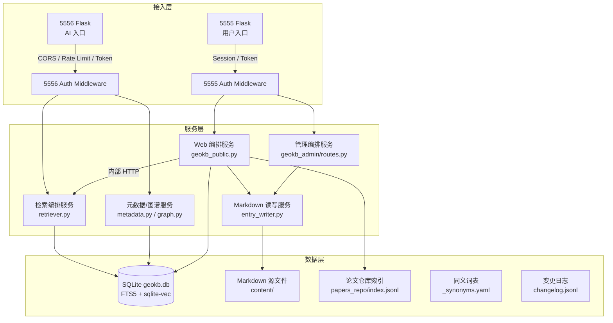

# GeoKB 三层服务端架构重设方案

> 目标：把现有 GeoKB 拆分为 **5556 AI 只读服务** 与 **5555 普通用户 Web 门户**，并建立统一的三层服务端架构。
> 状态：设计方案（未实施）。

---

## 1. 设计目标与边界

| 目标 | 5556（AI 服务） | 5555（用户门户） |
|---|---|---|
| 主要受众 | 公网 Agent / AI 模型（通过 `sjck.kust.work` 直链本地 5556） | 普通用户、团队内部成员 |
| 服务形态 | 纯 API + 轻量自描述界面（OpenAPI/API 索引页） | 可视化 Web 界面 |
| 访问鉴权 | API Token（Bearer） | 普通浏览无需 Token；词条编辑/删除需 GeoKB 管理 Token |
| 编辑权限 | **只读，永不开放写接口** | 提供条目 CRUD、概念延伸、划词查找、知识链 |
| 检索结果 | 按相关度排序，动态返回足够数量的高相关结果，取消固定 15 篇限制 | 同左，并在界面展示得分与排序依据 |
| 当前状态 | 已移除 `/admin`，仅保留展示页 + `/api` + `/health` + `/manifest` | 已新增 `geokb_admin` 蓝图，仅含管理功能 |

**关键假设（待确认可调整）**

1. 5556 的 API Token 使用 Bearer 方案，Token 存储在 `D:/ZSK/geokb/config/api_token.txt`，不对每个 Agent 分发个人密钥。
2. 5555 的普通浏览**无需登录**，与现有 5555 门户其它模块保持一致；写操作复用已有 `geokb_admin` Token。
3. 5555 的检索不直接加载向量模型，而是**内部调用 5556 `/api/search`**，避免在 5555 Python 环境中安装 `fastembed`/`sqlite-vec`。
4. 5556 不再保留面向人类的浏览页（首页、模块页、详情页），全部迁移到 5555。

---

## 2. 三层服务端架构



### 2.1 接入层

| 组件 | 5556 | 5555 |
|---|---|---|
| 监听地址 | `127.0.0.1:5556` | `127.0.0.1:5555` |
| 公网暴露 | 通过 `sjck.kust.work` 反向代理到本地 5556 | 不直接对外，仅内网门户 |
| 认证方式 | `Authorization: Bearer <api_token>` | 读：无；写：`session.geokb_admin` + Token |
| 跨域 | 允许 `sjck.kust.work` 及本地 5555 Origin | 仅同域 |
| 限流 | 每 IP 60 req/min | 每 IP 120 req/min |
| 职责 | 校验 Token、限流、记录访问日志 | 校验写权限、渲染页面、转发检索请求 |

### 2.2 服务层

| 服务 | 职责 | 主要文件 |
|---|---|---|
| 检索编排服务 | 查询扩展、BM25 + 向量候选、归一化、融合、动态截断、上下文装配 | `server/retriever.py` |
| 元数据/图谱服务 | 模块统计、同义词、相关条目推荐、知识链（tag 共现 + 向量近邻） | `server/metadata.py`（新建）、`server/graph.py`（新建） |
| Web 编排服务 | 5555 公共页面：搜索、详情、模块、论文、划词查找、概念延伸 | `modules/geokb_public/routes.py`（新建） |
| 管理编排服务 | 5555 管理页面：登录、Dashboard、条目 CRUD、重建索引触发 | `modules/geokb_admin/routes.py`（已有，扩展） |
| Markdown 读写服务 | 统一封装 frontmatter 解析/写入、git 快照、changelog | `server/entry_writer.py`（新建） |

### 2.3 数据层

数据层保持现有设计：

- **唯一事实来源**：`D:/ZSK/geokb/content/**/*.md` + YAML Frontmatter。
- **派生索引**：`D:/ZSK/geokb/index/geokb.db`（FTS5 + sqlite-vec）。
- **同义词表**：`D:/ZSK/geokb/content/glossary/_synonyms.yaml`。
- **论文索引**：`D:/PostNews/papers_repo/index.jsonl`。
- **变更日志**：`D:/ZSK/geokb/changelog.jsonl`。

---

## 3. 5556 AI 服务 API 设计

### 3.1 认证方式

所有 `/api/*` 请求必须携带 Header：

```http
Authorization: Bearer <api_token>
```

- Token 文件：`D:/ZSK/geokb/config/api_token.txt`，单行 `TOKEN=...`。
- 自描述接口 `/docs`、`/openapi.json`、`/health`、`/manifest` **不需要 Token**。
- 错误响应：

```json
{
  "ok": false,
  "error": "unauthorized",
  "message": "缺少或无效的 Authorization: Bearer Token"
}
```

### 3.2 自描述接口

| 端点 | 方法 | 说明 |
|---|---|---|
| `/docs` | GET | 人类可读的 API 索引页：列出所有端点、参数、认证方式、示例 |
| `/openapi.json` | GET | 完整 OpenAPI 3.1 规范 JSON |
| `/manifest` | GET | 知识库元数据：模块、条目数、模型、最近更新 |
| `/health` | GET | 健康检查与索引统计 |

### 3.3 API 端点清单

| 端点 | 方法 | 用途 | 主要参数 |
|---|---|---|---|
| `/api/search` | GET | 混合检索 | `q`, `module`, `tags`, `confidence_min`, `limit`, `min_score`, `score_ratio`, `token_budget`, `expand`, `fuzzy` |
| `/api/search/fuzzy` | GET | 模糊匹配兜底 | `q`, `module`, `limit` |
| `/api/entry/{id}` | GET | 单条详情（含 Markdown 正文） | — |
| `/api/entry/{id}/related` | GET | 相关条目推荐 | `limit`, `method` |
| `/api/module/{name}` | GET | 模块下全部条目 | — |
| `/api/modules` | GET | 模块列表与统计 | — |
| `/api/tags` | GET | 热门标签与数量 | `module` |
| `/api/synonyms/{term}` | GET | 查询同义词/英译 | — |
| `/api/expand` | GET | 概念延伸建议 | `q`, `limit` |
| `/api/graph/{id}` | GET | 知识链局部图（节点+边） | `depth`, `limit` |

### 3.4 请求与响应示例

**请求**

```http
GET /api/search?q=矽卡岩型钨矿&module=economic-geology&limit=20&score_ratio=0.55
Authorization: Bearer <token>
```

**响应**

```json
{
  "ok": true,
  "data": {
    "query": "矽卡岩型钨矿",
    "expanded_terms": ["矽卡岩", "skarn", "钨矿", "tungsten"],
    "strategy": "bm25+vector+rrf+adaptive-cutoff",
    "module_filter": "economic-geology",
    "hits_count": 12,
    "hits": [
      {
        "id": "eco-skarn-w",
        "title": "矽卡岩型钨矿床成矿特征",
        "module": "economic-geology",
        "tags": ["矽卡岩", "钨矿", "田坝心"],
        "summary": "...",
        "confidence": "A",
        "status": "active",
        "updated": "2026-10-13",
        "score": 0.9821,
        "matched_by": ["bm25", "vector"],
        "score_detail": { "bm25": 0.95, "vector": 0.91 },
        "body_chars": 3200
      }
    ],
    "index_built_at": "2026-10-14T01:30:00"
  }
}
```

### 3.5 参数语义

| 参数 | 类型 | 默认值 | 说明 |
|---|---|---|---|
| `q` | string | 必填 | 查询词 |
| `module` | string | null | 模块过滤 |
| `tags` | string | null | 逗号分隔标签过滤 |
| `confidence_min` | string | null | 最低可信度：`A`/`B`/`C`/`D` |
| `limit` | int | 0（自适应） | 最大返回数，上限 100；0 表示使用动态截断 |
| `min_score` | float | null | 绝对分数阈值（0–1） |
| `score_ratio` | float | 0.55 | 相对截断阈值：保留 `score >= max_score * ratio` |
| `token_budget` | int | null | 上下文 Token 预算，按摘要+标题+80 字符估算 |
| `expand` | bool | true | 是否启用同义词/概念扩展 |
| `fuzzy` | bool | true | 结果少于 `min_results` 时是否启用模糊兜底 |
| `format` | string | "summary" | `summary`（摘要）/ `full`（完整正文） |

### 3.6 错误码

| HTTP | 错误码 | 说明 |
|---|---|---|
| 400 | `bad_request` | 参数缺失或非法 |
| 401 | `unauthorized` | Token 缺失/无效 |
| 403 | `forbidden` | 该端点不允许访问 |
| 404 | `not_found` | 条目/模块不存在 |
| 429 | `rate_limited` | 请求过于频繁 |
| 503 | `index_unavailable` | 索引未就绪 |

---

## 4. 5555 用户门户界面与交互设计

### 4.1 路由结构

| 路由 | 访问权限 | 功能 |
|---|---|---|
| `/geokb` | 公开 | 知识库首页 + 全局搜索 |
| `/geokb/search?q=...` | 公开 | 检索结果页 |
| `/geokb/entry/{id}` | 公开 | 条目详情（渲染 Markdown、相关推荐、知识链） |
| `/geokb/module/{name}` | 公开 | 模块浏览 |
| `/geokb/papers` | 公开 | 论文仓库浏览 |
| `/geokb/admin` | 需管理 Token | 登录页 |
| `/geokb/admin/dashboard` | 需登录 | 管理仪表盘 |
| `/geokb/admin/entries` | 需登录 | 条目列表 |
| `/geokb/admin/entry/new` | 需登录 | 新建条目 |
| `/geokb/admin/entry/{id}/edit` | 需登录 | 编辑条目 |

### 4.2 公共页面组件

#### 4.2.1 全局搜索框

- 位置：`/geokb` 首页顶部 + 门户导航栏常驻。
- 支持：
  - 普通文本输入
  - 模块下拉过滤（`module:` 快捷语法）
  - 标签建议（输入时提示热门标签）
  - 搜索历史（localStorage，仅本地）

#### 4.2.2 检索结果页

- 左侧：过滤面板（模块、可信度、标签、更新日期）。
- 中间：结果卡片列表，显示：
  - 标题 + 模块/可信度徽章
  - 摘要高亮（命中词高亮）
  - 标签
  - 相关度分数与匹配通道（BM25 / 向量 / 模糊）
  - “相关知识链”按钮
- 右侧：概念延伸面板
  - 同义词提示："矽卡岩 → skarn"
  - 推荐扩展查询："添加：成矿流体、白钨矿"

#### 4.2.3 条目详情页

- 顶部：标题、模块、标签、可信度、来源、更新日期。
- 正文：Markdown 渲染（marked.js），带锚点 TOC。
- 划词快速查找：
  - 鼠标选中任意文本 → 弹出浮动工具条
  - 按钮：「在知识库中搜索」「查看同义词」「加入标签」
  - 点击后在侧边栏或浮层展示结果，不跳转页面。
- 知识链延伸：
  - 下方展示「相关条目」卡片（按 tag 共现 + 向量近邻排序）。
  - 展开后显示局部力导向图（ECharts / vis-network）：当前条目为焦点，邻居节点按相关度着色。

#### 4.2.4 模块浏览页

- 模块卡片网格，显示条目数与最近更新。
- 点击模块进入该模块条目列表。

### 4.3 管理端交互

- 与普通浏览共用导航，登录后顶部出现「管理」入口。
- 编辑器：EasyMDE（本地化），左侧编辑、右侧实时预览。
- 保存时：
  1. 前端校验 id/title/module/body 非空。
  2. 后端写入 Markdown → 记录 changelog → 异步触发 `scripts/rebuild_index.py`。
  3. 保存成功后跳转到 `/geokb/entry/{id}` 查看效果。

### 4.4 关键交互流程

```text
用户输入查询
    │
    ▼
5555 调用 5556 /api/search（内部 Bearer Token）
    │
    ▼
5556 返回 hits + expanded_terms + strategy
    │
    ▼
5555 渲染结果页
    │
    ├─ 点击条目 → /geokb/entry/{id}（直接读 SQLite 元数据 + Markdown）
    ├─ 划词 → 调用 /api/search?q=选中词&limit=5 → 侧栏浮层
    ├─ 概念延伸 → 调用 /api/expand → 更新查询建议
    └─ 知识链 → 调用 /api/entry/{id}/related 与 /api/graph/{id}
```

---

## 5. 检索排序策略与数量控制规则

### 5.1 检索漏斗

```
原始查询 q
    │
    ▼ 查询扩展
扩展词集 T = {q} ∪ synonyms(q) ∪ concept(q)
    │
    ├─► BM25 候选 Top 200（FTS5）
    └─► 向量候选 Top 200（sqlite-vec）
    │
    ▼ 归一化 + RRF 融合
融合分数 S_rrf
    │
    ▼ 元数据过滤 + 可信度加权
最终分数 S_final
    │
    ▼ 动态截断
返回列表 R
    │
    ▼ Token 预算裁剪（可选）
输出上下文 C
```

### 5.2 候选生成

| 通道 | 方法 | 分数含义 | 来源 |
|---|---|---|---|
| BM25 | `fts_entries` MATCH `T`，按 `bm25()` 升序 | 越小越相关，转换为 `score_bm25 = -bm25` | SQLite FTS5 |
| 向量 | `vec_entries` KNN，距离 `d` | `score_vec = 1 - d` | sqlite-vec + BAAI/bge-small-zh-v1.5 |
| 模糊 | 编辑距离 / 子串匹配 | `score_fuzzy` 命中即 0.3–0.7 | Python 回退 |

### 5.3 分数归一化

对 BM25 和向量分别做 Min-Max 归一化：

```python
norm(x, xs) = (x - min(xs)) / (max(xs) - min(xs) + 1e-9)
```

仅取各自 Top K（如 Top 50）做归一化，避免长尾拉低头部分数。

### 5.4 融合与加权

#### 方案 A：RRF（默认）

```python
rrf_score = Σ 1 / (k + rank_i)    # k = 60
```

RRF 对排名敏感，适合两种通道尺度不同的情况。

#### 方案 B：线性加权（可选，供调优）

```python
final = 0.6 * rrf_norm + 0.25 * bm25_norm + 0.15 * vec_norm
```

#### 可信度/状态加权

```python
conf_weight = {"A": 1.0, "B": 0.95, "C": 0.85, "D": 0.70}
status_weight = {"active": 1.0, "deprecated": 0.6, "deleted": 0.0}
final_score = base_score * conf_weight[conf] * status_weight[status]
```

`deleted` 条目直接过滤；`deprecated` 保留但降权。

### 5.5 动态数量控制

取消固定 15 篇。采用 **三层截断规则**：

```python
def adaptive_cutoff(hits, max_score, limit=0, score_ratio=0.55,
                    min_results=3, global_cap=50):
    """
    hits: 按 final_score 降序排列的列表
    """
    if limit > 0:
        return hits[:min(limit, 100)]

    selected = []
    threshold = max_score * score_ratio
    for i, hit in enumerate(hits):
        # 绝对阈值
        if hit["score"] < 0.15:
            break
        # 相对阈值
        if hit["score"] < threshold and len(selected) >= min_results:
            # 若相邻分数骤降，也截断
            if i > 0 and (hits[i-1]["score"] - hit["score"]) > 0.15:
                break
        selected.append(hit)
    return selected[:global_cap]
```

**规则说明**：

1. **显式 `limit`**：用户或 Agent 指定时优先满足，上限 100。
2. **自适应模式**（`limit=0`）：
   - 至少保留 `min_results=3` 条（即使低于相对阈值）。
   - 保留 `score >= max_score * score_ratio` 的结果，默认 `score_ratio=0.55`。
   - 若相邻结果分数差 `>0.15`，视为自然断层，提前截断。
   - 全局上限 `global_cap=50`，避免上下文爆炸。
3. **`token_budget`**：在自适应结果基础上，按摘要+标题+80 字符估算 Token，累计超过预算时截断。

### 5.6 模糊匹配兜底

当最终返回结果 `< min_results` 且 `fuzzy=true` 时：

1. 对查询词做子串匹配：`LIKE '%term%'`。
2. 使用 `rapidfuzz` 计算标题/摘要编辑距离，Top 10 作为候选。
3. 候选分数统一乘以 0.6 惩罚，再与主结果合并、重新排序。
4. 响应 `strategy` 字段标记为 `...-fuzzy-backfill`。

---

## 6. 数据一致性与写流程

```
5555 管理端保存
    │
    ▼
校验 frontmatter → 写 Markdown 源文件
    │
    ▼
记录 changelog.jsonl
    │
    ▼
git add + commit（快照）
    │
    ▼
异步触发 scripts/rebuild_index.py（GeoKB venv）
    │
    ▼
重建 FTS5 + sqlite-vec + meta 表
    │
    ▼
5556 只读服务读取新索引（无需重启）
```

**一致性保证**：

- 5556 仅读取索引，不缓存查询结果；写后 5556 立即生效。
- 5555 管理端只写普通 `entries` 元数据不直接写向量表；向量重建由 GeoKB venv 完成。
- 若重建失败，changelog 保留失败记录，管理端 Dashboard 展示最近一次重建状态。

---

## 7. 安全与性能

| 方面 | 方案 |
|---|---|
| API Token | 16–32 字节随机字符串，支持环境变量 `GEOKB_API_TOKEN` 覆盖；不提供公开注册 |
| CORS | 5556 仅允许 `sjck.kust.work` 与 `http://127.0.0.1:5555`；其它 Origin 返回 403 |
| 限流 | 5556 60 req/min/IP；5555 120 req/min/IP；超限时返回 429 |
| 输入安全 | 所有查询参数转义后用于 FTS5；禁止 SQL 拼接 |
| XSS 防护 | 5555 模板统一转义；Markdown 仅渲染标准语法，禁用 HTML |
| 缓存 | 5556 `/api/entry/{id}` 可设 5 分钟 ETag；检索结果不缓存 |
| 日志 | 记录请求路径、IP、状态码；不记录 Token 原文 |
| 监控 | `/health` 暴露索引版本、条目数、最后重建时间 |

---

## 8. 实施顺序建议

### Phase A：5556 API 纯化（高优先级）

1. 在 `server/app.py` 中移除展示页面路由（`/`、`/modules`、`/module/<name>`、`/entry/<eid>`、`/search`）。
2. 新增 `/docs`、`/openapi.json`、统一的 Token 校验中间件。
3. 扩展 `server/retriever.py` 实现动态截断、`min_score`、`score_ratio`、`fuzzy` 参数。
4. 新增 `server/metadata.py` 与 `server/graph.py` 实现 `/api/expand`、`/api/related`、`/api/graph`。
5. 离线语法检查 + 5556 重启验证。

### Phase B：5555 公共界面（中优先级）

1. 新建 `modules/geokb_public/__init__.py` 与 `routes.py`。
2. 创建模板：首页、检索结果、详情、模块浏览、论文列表。
3. 公共搜索调用 5556 `/api/search`（内部 Bearer Token）。
4. 详情页直接读取本地 SQLite + Markdown。
5. 更新 `modules/__init__.py` 注册公共蓝图；更新 `portal/registry.py` 入口由 `/geokb/admin` 改为 `/geokb`。
6. 离线验证 + `tools/restart_web.py` 重启 5555。

### Phase C：增强交互（低优先级，可分批）

1. 划词查找：详情页注入 `selection-popup.js`。
2. 概念延伸：后端 `/api/expand` + 前端推荐面板。
3. 知识链图：后端 `/api/graph/{id}` + 前端 ECharts 力导向图。
4. 模糊匹配：集成 `rapidfuzz` 作为检索兜底。

---

## 9. 验证清单

| # | 验证项 | 通过标准 |
|---|---|---|
| 1 | 5556 `/docs` 无需 Token 可访问，且列出全部端点 | 200 + 含 `/api/search` |
| 2 | 5556 `/api/search` 不带 Token 返回 401 | 401 且 JSON 含 `unauthorized` |
| 3 | 5556 搜索「钨矿」返回结果数不再固定为 15，且含 `strategy` | 命中数 ≥3，字段完整 |
| 4 | 5555 `/geokb` 无需 Token 可访问 | 200 |
| 5 | 5555 搜索调用 5556 成功 | 结果页渲染与 5556 API 一致 |
| 6 | 5555 管理端保存条目后，5556 可立即检索到 | 保存后 5 秒内可命中 |
| 7 | 划词查找弹层正常 | 选中文本后出现搜索按钮并返回结果 |
| 8 | 知识链图渲染 | 详情页展开图后显示节点与边 |

---

## 10. 待用户确认事项

1. **5556 是否保留任何展示页面？** 建议只保留 `/docs` 作为 API 索引，其余全部迁到 5555。
2. **API Token 是否按单 Token 方案？** 还是为不同 Agent 分发独立 Token？
3. **5555 公共搜索是否允许未登录用户调用 5556？** 当前设计允许，通过服务端内部 Token。
4. **`score_ratio` 默认 0.55 是否合适？** 可在实施后通过验收测试调整。
5. **模糊匹配库选择**：`rapidfuzz` 性能更好，是否允许安装到 GeoKB venv？
